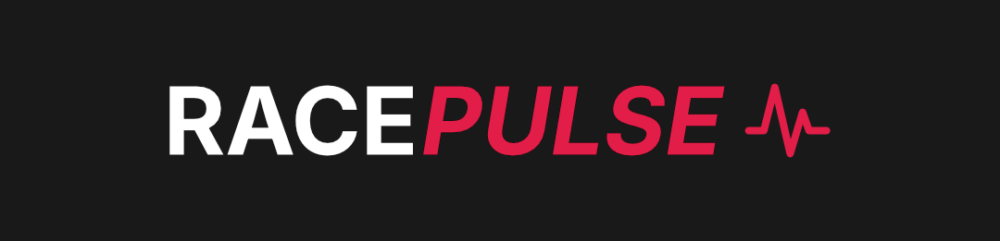
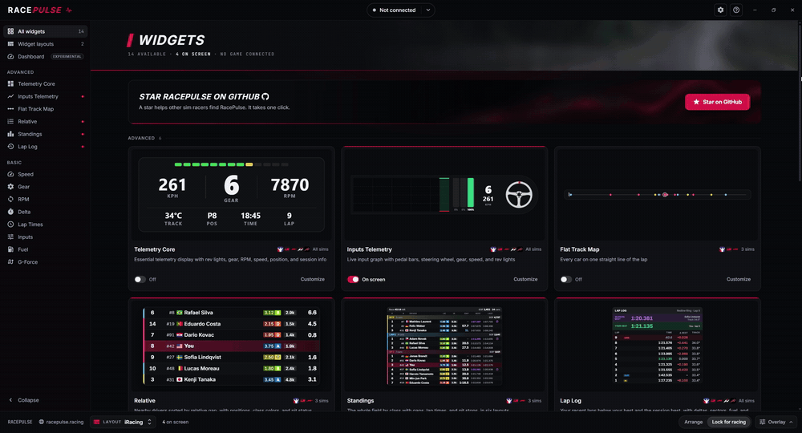
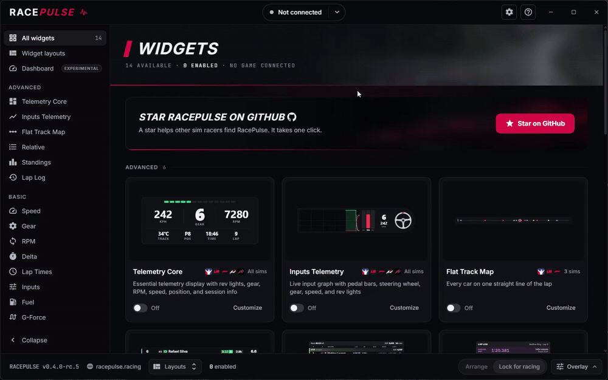

RacePulse gives you real-time telemetry overlays for sim racing. Lightweight, modular widgets that float over your game for speed, throttle/brake inputs, lap times, fuel, standings, and more. Auto-detects iRacing, Assetto Corsa Competizione, Assetto Corsa, Le Mans Ultimate, F1 25, and F1 24. Single `.exe`, no installer.

If RacePulse improves your setup, please consider giving this repo a star. It helps more sim racers discover the project.

**Website:** [racepulse.racing](https://racepulse.racing/) - full feature breakdown, live previews, and setup guides.

**Download:** [Latest Release](https://github.com/gAlexander77/racepulse-release/releases)

## Free Features (Current)

- iRacing, Assetto Corsa Competizione, Assetto Corsa, Le Mans Ultimate, F1 25, and F1 24 support with auto-detection
- 14 overlay widgets
  - Basic: Speed, Gear, RPM, Lap Times, Delta, Inputs, Fuel, and G-Force
  - Advanced: Telemetry Core, Inputs Telemetry, Flat Track Map, Relative, Standings, and Lap Log
- Per-widget customization on a Customize page with a live preview
- Widget layouts: save the widgets on screen and switch between setups
- Arrange widgets by dragging them on your monitor, then lock them for racing (click-through)
- Widgets hide while no game is sending telemetry (Only show with telemetry, on by default)
- Country flags in Relative and Standings (iRacing, F1, and Le Mans Ultimate online servers)
- US or UK English, a Settings window, and a getting-started Help guide
- Telemetry dashboard for a second screen (experimental)
- Single executable download (no installer)

## Quick Start

1. Download `RacePulse.exe` from [Releases](../../releases)
2. Launch it (no install required)
3. Start your sim (iRacing, ACC, AC, LMU, F1 25, or F1 24) and load into a session. RacePulse auto-connects. LMU and F1 need one in-game setting first; see [Supported Games](#supported-games).
4. In **All widgets**, turn on the widgets you want, drag them into place, and choose **Lock for racing** in the bottom bar

## Preview

**Main Application**

**Widget Customization**

## What this repository is for

This repo is the public release, documentation, issue tracking, and Hugo website home for RacePulse.

- Download portable Windows executables with SHA-256 checksums
- Read feature documentation and setup guides
- Track release notes and known issues

The main RacePulse application source code is private and not published in this repository. Builds run in the private source repository and arrive here as verified drafts; this repo owns public distribution and the website. See [RELEASING.md](RELEASING.md) for the handover and publication checks.

## Download

Get the latest build from [Releases](../../releases).

Each release includes:

- `RacePulse.exe` (main application)
- `RacePulse.exe.sha256` (download integrity checksum)
- `release-manifest.json` (build record: version, tool versions, and file sizes and hashes)

RacePulse also updates itself: it checks for new versions when it starts and offers to download, verify, and install them. Your settings, widget places, and layouts live in `%USERPROFILE%\.racepulse` and are kept across updates.

## Supported Games

| Game                           | Transport     | Setup                                                                                                   |
| ------------------------------ | ------------- | ------------------------------------------------------------------------------------------------------- |
| **iRacing**                    | Shared memory | No configuration needed. Detected automatically when iRacing is running                                 |
| **Assetto Corsa Competizione** | Shared memory | No configuration needed. Detected once you load into a session (not from the main menu)                 |
| **Assetto Corsa**              | Shared memory | No configuration needed. Detected once a session is loaded (the main menu is a separate launcher)        |
| **Le Mans Ultimate**           | Shared memory | Enable Plugins in LMU's Gameplay settings; uses the built-in shared memory interface                    |
| **F1 25**                      | UDP           | Enable UDP telemetry in game settings and set the port to 22025, 22024, 22023, or 20777 (format 2025)   |
| **F1 24**                      | UDP           | Enable UDP telemetry in game settings and set the port to 22025, 22024, 22023, or 20777 (format 2024)   |

RacePulse automatically detects which game is running and begins capturing telemetry. If F1 doesn't connect, another app may be using that port: pick another of these ports in the game.

Relative, Standings, and Flat Track Map work in iRacing, Le Mans Ultimate, and F1. Delta works in iRacing, Le Mans Ultimate, and ACC. Every other widget works in all six games.

## Core Features

- Real-time racing telemetry overlays for iRacing, ACC, Assetto Corsa, Le Mans Ultimate, F1 25, and F1 24
- Modular widget system (speed, gear, RPM, delta, inputs, fuel, G-force, relative, standings, lap log, and more)
- Per-widget customization with persistent settings
- Widget layouts that remember their widgets, places, sizes, settings, and monitors
- Arrange and Lock for racing (click-through), with an Overlay menu for Only show with telemetry, Recenter, and Turn all off
- Session recording to local storage
- Single executable distribution — no installer required

## System Requirements

- Windows 10/11 (64-bit)
- Graphics driver with desktop composition enabled
- For F1 games: UDP telemetry enabled in game settings, sent to one of RacePulse's ports
- For Le Mans Ultimate: Enable Plugins turned on in the game's Gameplay settings

## Documentation

- See `docs/features.md` for an end-user feature overview
- See `docs/install.md` for installation, first-run setup, and upgrading
- See `CHANGELOG.md` for release history

## License

This repository is distributed under a proprietary binary-use license.
See `LICENSE` and `EULA.md`.
